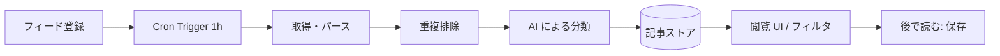

# アーキテクチャの概要

## 前提

- 実行基盤は Cloudflare、言語は TypeScript（[ADR-0001](adr/0001-cloudflare-typescript.md)）

## 処理の流れ

## 構成要素（候補。確定したものから ADR 化する）

| 役割 | 候補 | 状態 |
| --- | --- | --- |
| API / UI | Workers + Hono + Zod（[ADR-0004](adr/0004-hono-zod.md)） | 採用 |
| 定期実行 | Cron Triggers | 想定 |
| クロールの分散 | 不要（Cron 1 本で並列数を絞る） | 想定 |
| データベース | D1（[ADR-0003](adr/0003-d1-r2-vectorize.md)） | 採用 |
| 判断（分類・除外・重複確認） | Jev（[ADR-0002](adr/0002-ai-division.md)） | 採用 |
| 埋め込み | Workers AI + Vectorize | 採用 |
| アーカイブ保存 | R2（形式は未決） | 採用（形式のみ未決） |

## ディレクトリ構成

`src/` の構成と依存の向き、テストの置き場所は [ADR-0008](adr/0008-src-layout.md) に従う。

## 未決事項

- 重複判定の方式（URL 正規化、本文ハッシュ、埋め込み類似度）
- 分類の方式（固定トピック、自由タグ、ユーザー定義）
- アーカイブ形式
