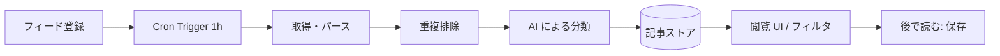

# アーキテクチャの概要

## 前提

- 実行基盤は Cloudflare、言語は TypeScript（[ADR-0001](adr/0001-cloudflare-typescript.md)）

## 処理の流れ

## 構成要素（候補。確定したものから ADR 化する）

| 役割 | 候補 | 状態 |
| --- | --- | --- |
| API / UI | Workers | 想定 |
| 定期実行 | Cron Triggers | 想定 |
| クロールの分散 | Queues | 未定 |
| データベース | D1 / その他 | **未決** |
| 分類・埋め込み | Workers AI / Vectorize | 未定 |
| アーカイブ保存 | R2 | 未定（形式も未決） |

## 未決事項

- データベースの選定
- 重複判定の方式（URL 正規化、本文ハッシュ、埋め込み類似度）
- 分類の方式（固定トピック、自由タグ、ユーザー定義）
- アーカイブ形式
