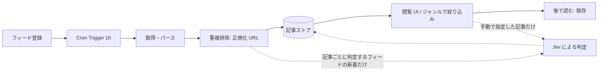

# アーキテクチャの概要

## 前提

- 実行基盤は Cloudflare、言語は TypeScript（[ADR-0001](adr/0001-cloudflare-typescript.md)）

## 処理の流れ

選別の基本はフィードに付けたジャンルで、AI は呼ばない。Jev を使うのは、複合的なサイト、手動指定の記事、特定サイトの最近の記事、常に判定が必要と指定したサイトに限る（[ADR-0011](adr/0011-ai-scope.md)）。

## 構成要素（候補。確定したものから ADR 化する）

| 役割 | 候補 | 状態 |
| --- | --- | --- |
| API / UI | Workers + Hono + Zod（[ADR-0004](adr/0004-hono-zod.md)） | 採用 |
| 定期実行 | Cron Triggers（毎時、`src/jobs/crawl.ts`）。取得の後に、記事ごとに判定するフィードの未判定記事を上限件数まで Jev で判定する（`src/jobs/judge.ts`）。「該当なし」と答えた記事も該当なしとして保存し、再判定しない（[ADR-0015](adr/0015-judgment-none.md)） | 採用 |
| クロールの分散 | 不要（Cron 1 本で並列数を絞る） | 採用 |
| データベース | D1（[ADR-0003](adr/0003-d1-r2-vectorize.md)） | 採用 |
| 選別 | フィード単位のジャンル（AI なし）。複合的なサイトなど限定した対象だけ Jev（[ADR-0011](adr/0011-ai-scope.md)）。Jev の呼び出しは `src/ai/jev.ts`、判定と保存は `src/jobs/judge.ts` | 採用 |
| シークレット（Jev の API キー） | Workers Secrets（[ADR-0009](adr/0009-workers-secrets.md)、登録手順は [dev/secrets.md](dev/secrets.md)） | 採用 |
| 埋め込み | Workers AI + Vectorize | 不採用（[ADR-0011](adr/0011-ai-scope.md)） |
| アーカイブ保存 | R2、本文を Markdown で保存（[ADR-0014](adr/0014-archive-format.md)） | 採用 |

## ディレクトリ構成

`src/` の構成と依存の向き、テストの置き場所は [ADR-0008](adr/0008-src-layout.md) に従う。

## 未決事項

- アーカイブの取得・本文抽出の方法（TASK-19 で選ぶ。形式は [ADR-0014](adr/0014-archive-format.md)）

重複判定（正規化 URL のみ）と分類の方式（ユーザー定義のジャンル）は [ADR-0011](adr/0011-ai-scope.md) で決めた。
